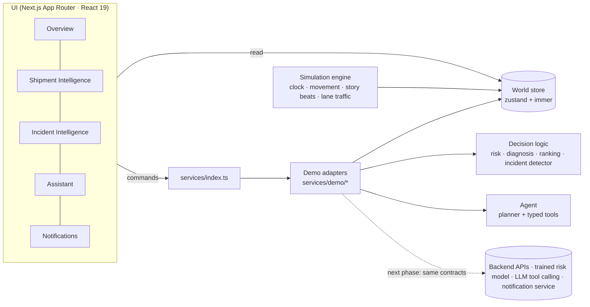

# دلّال · Dallal

**Intelligent operations for disrupted and at-risk last-mile shipments.**

Dallal helps an exception-desk analyst see which shipments need attention, catch failures *before* they happen, understand what really happened from journey evidence (not a single exception code), recover with transparent, ranked actions, let a tool-using agent investigate each case — and recognise when many failures are really **one operational incident**.

> **Prototype notice.** This is the interactive product prototype for the qualification stage. Roads and places are real (OpenStreetMap, Dammam · Al Khobar · Dhahran). Shipments, recipients, events, risk scores and incidents are **simulated** and labelled `SIM` in the UI. The in-browser risk scores are prototype heuristics; trained models live only in the optional backend (below). No SPL system or data is used, and no email leaves the browser.

> **Live AI backend (optional).** `backend/` is a real Python service: a decision-theoretic agent that can *ask people on WhatsApp* when the databases cannot settle a case, coordinated recovery for shared-cause incidents, and three trained risk models. The UI connects to it when reachable (top-bar pill **Live backend** / **WA SANDBOX**) and otherwise runs on the in-browser prototype logic (**Simulated**). Anything produced by the backend is tagged `LIVE`; sandbox WhatsApp is tagged `SANDBOX` and never reaches a phone. Shipments, couriers, recipients, spare capacity and outcomes remain simulated. See [AI/ML backend](#aiml-backend).

---

## Contents

- [The product](#the-product)
- [Screens](#screens)
- [Demo walkthrough](#demo-walkthrough)
- [Run it](#run-it)
- [Architecture](#architecture)
- [Map implementation](#map-implementation)
- [Agent architecture](#agent-architecture)
- [Decision logic](#decision-logic)
- [Assistant](#assistant)
- [What is real vs. simulated](#what-is-real-vs-simulated)
- [From prototype to production](#from-prototype-to-production)
- [Design & accessibility](#design--accessibility)
- [AI/ML backend](#aiml-backend)
- [Data sources & attribution](#data-sources--attribution)

---

## The product

The loop Dallal is built around:

**Prevention → Detection → Diagnosis → Recovery → Agentic action → Outcome → Learning**

| Capability | What the analyst gets |
|---|---|
| **Predicted risk** | Shipments flagged *before* failing (e.g. address confidence collapses), with the drivers behind the score. |
| **Evidence-based diagnosis** | The recorded exception code is checked against GPS dwell, contact logs, recipient confirmations, corridor telemetry and scans — and Dallal says so when they **conflict**. |
| **Transparent recovery ranking** | Only actions that fit the diagnosed cause, ordered by a visible formula with every term labelled *rule*, *assumption* or *simulated*. Never a probability, never "uplift". |
| **Tool-using agent** | The agent picks its next tool from what it has found. An address case, a code conflict and an unknown pattern visibly take **different paths**. |
| **Confidence-aware action** | Low-impact, reversible actions can run automatically; conflicting evidence, unknown patterns and high-impact actions are **escalated to the shift supervisor**. |
| **Incident intelligence** | A rolling-baseline detector turns “5 separate failure alerts” into **1 operational incident** with the shipments exposed next and one group response. |
| **Assistant** | Natural-language questions answered from live operations data with KPIs, charts, shipment/incident cards and map actions. |
| **Outcome ledger** | Every decision is recorded with its eventual outcome — the data a production system would learn from. |

## Screens

| Route | Screen | Highlights |
|---|---|---|
| `/` | **Operations overview** | KPI strip that doubles as a filter · priority queue (incidents → needs a decision → disrupted → at risk → recovering → on track) · live MapLibre map with moving parcels · incident banner |
| `/shipments/[id]` | **Shipment Intelligence** | Header with embedded route map · decision bar that always states the next step · recorded-code-vs-evidence comparison · ranked recovery options · live agent trace · journey timeline · recipient, address and order details |
| `/incidents/[id]` | **Incident Intelligence** | “N alerts → 1 incident + exposed” consolidation · corridor map with incident zone and proposed reroute · shared signals and detector chart · member table · group response with supervisor approval · resolution |
| `/incidents` | Incidents | Open and resolved incidents with detector sparklines |
| `/shipments` | Shipments | Active, needs attention, awaiting supervisor, closed today, **outcome ledger** |
| `/notifications` | Notifications | Escalations, incidents, agent actions, approvals, outcomes and the simulated email log |
| Drawer | **Dallal Assistant** | Suggested prompts, rich answer blocks, “Show on map” |
| Drawer | **Escalate to shift supervisor** | Prefilled from the agent run: reason, unresolved question, checks, evidence, options, SLA, location, operator note, email preview |

## Demo walkthrough

Open the app — the story plays automatically. For a live pitch, open the **clock pill → Demo director** (or start with `/?demo=manual`) and advance with **Next event**. The director also lists the eight story steps and ticks them off.

1. **Overview.** Most shipments are on track; parcels move along real roads between Dammam and Al Khobar.
2. **A shipment becomes at risk.** `DL-20417`'s National Address validation fails; its route turns amber and the queue reprioritises.
3. **Prevent it.** Open `DL-20417` → *Investigate with agent*. Path: `get_shipment → predict_risk → get_address_context → analyze_disruption → rank_recovery_actions → retrieve_policy_constraints`. The top action is safe to automate → *Run automated action* → the recipient confirms the pin → **Failure prevented**.
4. **A failure contradicts its code.** `DL-20481` is logged “Recipient not available” while its van is still held on King Fahd Rd. Investigate: `get_shipment → get_journey → analyze_disruption → get_route_context → check_incident_context → rank_recovery_actions → retrieve_policy_constraints`. Evidence conflicts with the code; the best action (reassign courier, COD SAR 2,450) needs approval.
5. **Escalate to a human.** *Escalate to shift supervisor* → review the prefilled drawer → send. In-app notification, simulated email (preview it), timeline update, status **Awaiting supervisor**.
6. **Many failures → one incident.** More vans fail on the same corridor. Instead of more alerts, the queue folds them into **INC-2417 · Route DK-04 disruption**. Open it: shared signal, detector z-score, exposed shipments, *Apply group response* (supervisor approval, reroute via King Saud Rd, resume held vans, notify recipients) → *Resolve incident*.
7. **Ask “What happened today?”** KPIs, exceptions vs. recoveries by hour, top causes, open incidents.
8. **Ask “Where is DL-20481?”** Live shipment card → *Show on map* flies the overview map to it.

Other cases worth opening: `DL-20562` (repeated missed windows), `DL-20655` (three failed attempts → *Approve & run* redirect), `DL-20598` (unknown custody pattern the agent refused to guess — already escalated), `DL-20776` (same-day promise at risk), `DL-20910` (recovered automatically earlier today).

## Run it

Requirements: **Node.js ≥ 20.9** and npm.

```bash
npm install
```

```bash
npm run dev
```

Then open <http://localhost:3000>. Add `?demo=manual` to disable auto-play.

| Script | Purpose |
|---|---|
| `npm run dev` / `npm run build` / `npm start` | Next.js dev server, production build, production server (both copy the MapLibre worker first) |
| `npm run lint` · `npm run typecheck` | ESLint (Next + React Compiler rules) · TypeScript |
| `npm run routes:generate` | Re-fetch real road geometry for the demo routes (see below) |

The basemap loads from OpenFreeMap / CARTO; without internet the map switches to a network-only style and everything else keeps working.

## Architecture



```
app/                 routes (overview, shipments, incidents, notifications)
components/
  layout/            shell, sidebar, top bar, demo director, command palette, toasts
  map/               NetworkMap (MapLibre), markers, route features, basemap styling, legend
  overview/          KPI strip, priority queue, incident banner, map cards
  shipments/         Shipment Intelligence sections, shipments table, ledger
  agent/             agent trace panel
  incidents/         Incident Intelligence sections, group response dialog
  escalation/        escalation drawer, email preview
  notifications/     bell, list, notifications screen
  assistant/         drawer, rich answer blocks
  charts/            detector chart, hourly chart, ranked bars
data/
  geo/               places.json, routeSpecs.json, routes.generated.json (real road geometry)
  scenario/          seeded shipments, incidents, notifications, ledger, lane traffic
services/
  contracts.ts       ShipmentService · RiskService · IncidentService · AgentService · AssistantService · NotificationService
  index.ts           binds contracts to implementations (swap here for API adapters)
  demo/              deterministic adapters over the world store
  agent/             tool implementations + planner
  logic/             risk heuristic, diagnosis, ranking, incident detector, movement, escalation drafts
simulation/          initial world, story beats, engine (tick, deliveries, dispatch, presenter controls)
store/               world store (client state cache) and UI store
types/               domain and assistant contracts
```

**Why it is replaceable:** components read the world through hooks and issue commands through the service registry. A production adapter implements the same contracts over REST/SSE and hydrates the same store — the screens do not change.

## Map implementation

- **MapLibre GL JS 6** with OpenStreetMap vector tiles from **OpenFreeMap** (no key), **CARTO Positron** fallback and an **offline network-only** style. Layers are re-tinted at runtime into Dallal's cool light palette; shields and POIs are removed; city labels stay bilingual (Latin / Arabic).
- MapLibre 6 ships its web worker as separate ES modules, so `scripts/copy-maplibre-worker.mjs` copies them to `public/vendor/` before `dev`/`build` and the app calls `setWorkerUrl()`.
- **Real roads, simulated shipments.** `scripts/generate-routes.mjs` asked the public OSRM router once for every demo route (facility → neighbourhood) and committed the simplified geometry. Exactly the Khobar-bound routes share **King Fahd Rd**, which is where the simulated lane closure happens; the reroute follows King Saud Rd / Prince Sultan Rd.
- **Movement.** Each vehicle has a closed-form position: constant speed, then a smooth exponential crawl into a traffic queue or next stop. The map evaluates it every animation frame; the simulation re-anchors it when plans change, so markers never jump. The operations clock runs at **10×**, keeping ETAs consistent with what moves on screen.
- **Route language** (adapted from the reference recording): travelled segment muted blue-grey · upcoming segment in status color (green on track, amber at risk, red disrupted, dashed violet human review, blue recovering) · white flow dashes show direction on focused routes · incident zones and corridor glow. Status is always also carried by marker icons and labels.
- Parcel markers are DOM elements positioned by MapLibre and rendered by React portals; facilities group held parcels with a count badge.

## Agent architecture

- **Typed tools** (`services/agent/tools.ts`): `get_shipment`, `get_journey`, `get_address_context`, `get_route_context`, `predict_risk`, `analyze_disruption`, `check_incident_context`, `rank_recovery_actions`, `retrieve_policy_constraints`, and action tools `contact_recipient`, `reschedule_delivery`, `redirect_to_pickup`, `escalate_case`. Tools return facts; the agent never invents numbers. Action tools only touch the demo world.
- **Planner** (`services/agent/planner.ts`): a deterministic policy that chooses the next tool from observations so far — the stand-in for an LLM with function calling. Different evidence → different paths:

| Case | Path |
|---|---|
| Address risk (`DL-20417`) | shipment → risk → address → evidence → rank → policy → *automate* |
| Code conflict (`DL-20481`) | shipment → journey → evidence → route → incident context → rank → policy → *escalate* |
| Missed windows (`DL-20562`) | shipment → journey → risk → evidence → rank → policy → *automate* |
| SLA at risk (`DL-20776`) | shipment → risk → route → evidence → rank → policy → *recommend* |
| Unknown pattern (`DL-20598`) | shipment → journey → evidence → route → incident context → *escalate, no guessing* |
| Incident member | shipment → incident context → *handle at incident level* |

- **Visible trace**: tool name, what it checked, result summary and facts — no hidden chain-of-thought. Earlier runs in the seed data are produced by the same planner.
- **Human in the loop**: policy requires supervisor approval for high-impact actions or custody changes on COD ≥ SAR 1,000; unknown patterns are always escalated.

## Decision logic

All real computation, clearly labelled, running on simulated inputs:

- **Risk** (`services/logic/risk.ts`) — a *prototype heuristic*: transparent additive score over address confidence, missed windows, corridor slowdown, stalled scans, SLA slack and more. It is not a trained model and no accuracy is claimed.
- **Diagnosis** (`services/logic/diagnosis.ts`) — evidence rules for address issues, genuine recipient unavailability, attempts not physically completed, route disruption, facility backlog, pickup-point outages, stop sequencing and unexplained custody patterns; states *agrees*, *conflicts* or *inconclusive*.
- **Ranking** (`services/logic/ranking.ts`) — `score = 4·fit + 2·urgency + 1·(low impact) + 0.5·reversible`, plus approval policy.
- **Incident detector** (`services/logic/incidentDetector.ts`) — failures per corridor in a 30-minute window vs. the corridor's rolling baseline; flags when `z ≥ 3` and at least 3 failures; exposed shipments are those whose remaining route crosses the incident zone.

## Assistant

`services/demo/assistantService.ts` routes a question to an intent and **computes** the answer from current state — shipment location, why it is disrupted, what the agent did, today's summary, attention list, high-risk shipments, incidents, supervisor approvals, route ranking and cause lists — returning text plus typed blocks (`kpis`, `shipment`, `incident`, `hourly_chart`, `bar_chart`, `agent_trace`, `approvals`, `actions`, …). An LLM with tool calling can later return the same `AssistantResponse` shape without UI changes.

## What is real vs. simulated

| Real | Simulated (labelled `SIM`) |
|---|---|
| Road network, districts and places (OpenStreetMap) | Shipments, recipients, merchants, couriers, facilities' operational state |
| Route geometry along real roads (OSRM) | Journey events, recipient replies, supervisor responses |
| Diagnosis rules, ranking formula, incident detector, agent planner — executed live | Risk scores (prototype heuristic, not a trained model) |
| Notification and escalation workflow | Email delivery (preview only) and the King Fahd Rd lane closure |

## From prototype to production

1. **Risk model** — train and evaluate the failure-risk model on a proper temporal split; expose it behind `RiskService` / `predict_risk()` and show its real test metrics.
2. **Agent** — replace the planner with an LLM using the same typed tools and trace format; keep policy checks outside the model.
3. **Data & actions** — implement API adapters for shipments, scans, telemetry and recovery actions against the operator's systems (today everything touches only the demo world).
4. **Notifications** — connect `NotificationService` to real in-app, email and mobile approval channels.
5. **Learning loop** — use the outcome ledger to evaluate and improve rankings with real intervention/outcome data.
6. **Governance** — PDPL-compliant data handling, role-based access, audit logging, monitoring.

## Design & accessibility

- Light, calm operational theme: cool neutrals, blue for actions, green / amber / red / violet reserved for status and always paired with icons and labels.
- Muted text tokens meet WCAG AA contrast; charts use validated colors, direct labels and screen-reader tables.
- Keyboard: `⌘K` search and ask, `⌘J` assistant, focus-visible rings, queue rows operable by keyboard, skip link.
- Motion communicates state (moving parcels, queue consolidation, agent steps, drawers) and respects `prefers-reduced-motion`.
- Desktop-first (1440 / 1366), usable at 1024 with an auto-collapsing sidebar.

## AI/ML backend

`backend/` (Python 3.11+, FastAPI, SQLite) holds the data pipeline, trained models, the v2 agent, the WhatsApp channel and the coordinated-recovery solver. The frontend talks to it through `lib/live/*` and falls back gracefully when it is absent.

| What | Where | Doc |
|---|---|---|
| Critical review of v1 and the v2 decision architecture (ensemble belief, net value of information, bounded autonomy) | `backend/dallal/agent/v2/` | [Agent v2](docs/architecture/AGENT_V2.md) |
| Active inquiries over WhatsApp (sandbox + Cloud API), durable pause/resume, idempotent webhooks | `backend/dallal/channels/`, `service.py`, `store.py` | [WhatsApp](docs/integration/WHATSAPP.md) |
| Coordinated network recovery (joint MILP, one shared question with recourse, supervisor approval) | `backend/dallal/recovery/network.py`, `plans.py` | [Agent v2 §5](docs/architecture/AGENT_V2.md#5-coordinated-network-recovery) |
| Real-data risk models (calibrated, feature-contract, abstaining) and the Model Lab page | `backend/dallal/ml/`, `backend/artifacts/`, `/models` | [Experiments, Part A](docs/experiments/README.md) |
| Guarded LLM planner (Qwen via Ollama) and reply-interpretation benchmark | `backend/dallal/agent/v2/llm_planner.py`, `eval/` | [Experiments](docs/experiments/README.md) |
| Experiments (synthetic decisions kept apart from real-data metrics) | `backend/dallal/sim/`, `eval/` | [Experiments](docs/experiments/README.md) · [headline trace](docs/experiments/headline_trace.md) |
| Dataset audit, canonical schema, augmentation, baselines | `backend/registry/`, `dallal/data/`, `dallal/ml/` | [Dataset report](docs/data/DATASET_DECISION_REPORT.md) · [Schema](docs/data/CANONICAL_SCHEMA.md) · [Augmentation](docs/data/AUGMENTATION.md) · [Baselines](docs/ml/TASKS_AND_BASELINES.md) |
| Deployment (Vercel frontend + container backend) | `backend/Dockerfile`, `render.yaml`, `app/api/dallal` | [Deployment](docs/deployment/DEPLOYMENT.md) |

```bash
# backend
cd backend && uv venv && source .venv/bin/activate && uv pip install -e ".[dev,api]"
python -I -m pytest -q
DALLAL_TIME_SCALE=30 python -m uvicorn dallal.api.app:app --port 8000     # sandbox WhatsApp; no secrets needed
# frontend (another terminal): the dev server connects to http://localhost:8000 automatically
npm run dev            # open /shipments/DL-20764?demo=manual  (live agent asks the courier), /incidents/INC-2417 (Plan with the backend), /models
```

Datasets are never committed: `python -I -m dallal.data.cli fetch selected --all` reproduces them (hash-verified); training needs them (`python -I -m dallal.ml.train`), serving does not (the three small calibrated artifacts are committed and SHA-256 checked on load).

**Status, honestly.** Real: the three trained models and their held-out metrics (other countries' data, not SPL); the agent, solver, durable runtime and sandbox channel running live in the UI. Not real: any SPL data, any delivered WhatsApp message (the Cloud API provider is implemented but has never talked to Meta), every shipment/courier/recipient, spare-courier capacity, response rates and utilities (assumptions), and all decision experiments (synthetic, assumption-based). The backend is packaged for deployment but not deployed from this environment.

## Data sources & attribution

- Map data © [OpenStreetMap contributors](https://www.openstreetmap.org/copyright) (ODbL), tiles by [OpenFreeMap](https://openfreemap.org) / [CARTO](https://carto.com/attributions).
- Route geometry computed once with the [OSRM](https://project-osrm.org) public demo server.
- Place names geocoded with [Nominatim](https://nominatim.org). All operational records are fictional.
- **Backend datasets** (reproduced from source, never redistributed; full terms in `backend/registry/datasets.yaml`): [Cainiao LaDe](https://huggingface.co/datasets/Cainiao-AI/LaDe) (Wu et al., KDD 2024) · [Amazon Last Mile Routing Research Challenge](https://registry.opendata.aws/amazon-last-mile-challenges) (© Amazon.com, Inc., CC BY-NC 4.0) · [Last-mile route deviations, planned vs. actual](https://data.mendeley.com/datasets/kkwgfvmtxn/1) (Konovalenko, Hvattum, Iversen; CC BY 4.0) · [Olist Brazilian E-Commerce](https://www.kaggle.com/datasets/olistbr/brazilian-ecommerce) (CC BY-NC-SA 4.0) · Saudi Post | SPL Open Data Platform (areas, cities, offices) · [OCEL 2.0 Order Management](https://zenodo.org/records/8428112) (CC BY 4.0, simulated) · [Cargo 2000](https://archive.ics.uci.edu/dataset/382/cargo+2000+freight+tracking+and+tracing) (Metzger et al., CC BY 4.0) · [DataCo Smart Supply Chain](https://data.mendeley.com/datasets/8gx2fvg2k6/5) (CC BY 4.0, benchmark only). Amazon and Olist are non-commercial licenses: fine for this hackathon/research use, not for a commercial deployment.
